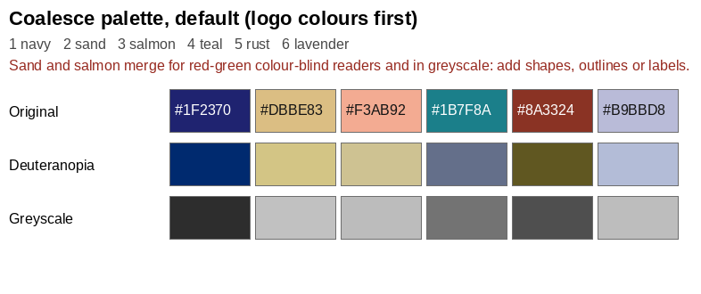

# coalescepal

Colours based on the Coalesce Lab logo, for R and ggplot2.



## Install

```r
# install.packages("remotes")
remotes::install_github("<lab-or-user>/coalescepal")
```

Pin a version for reproducible figures: `remotes::install_github("<lab-or-user>/coalescepal@v0.1.0")`.

## Use

```r
library(coalescepal)
library(ggplot2)

ggplot(mpg, aes(displ, hwy, colour = drv, shape = drv)) +
  geom_point(size = 3) +
  scale_colour_coalesce(3, mode = "screen") +
  scale_shape_coalesce(3)
```

`coalesce_pal(n, mode)` returns 2 to 6 colours.

| mode | colours | use |
|---|---|---|
| `"logo"` (default) | navy, sand, salmon, teal, rust, lavender | posters, talks, with a second cue |
| `"screen"` | logo colours, never sand and salmon as two series | colour-blind safe, up to 5 colours |
| `"print"` | navy, rust, teal, ochre, lavender, cream | black-and-white print |

**Caution.** Sand and salmon look almost identical with red-green colour
blindness and print as the same grey. When a figure uses both, add a shape
(`scale_shape_coalesce()`), an outline or direct labels. Silence the warning
with `options(coalesce.quiet = TRUE)`.

Continuous ramps: `coalesce_seq`, `coalesce_seq_warm`, `coalesce_div`, with
`scale_fill_coalesce_seq()` and `scale_fill_coalesce_div()`.

## Develop

```r
devtools::document()   # builds man/ and NAMESPACE from the roxygen comments
devtools::test()
devtools::check()
```
